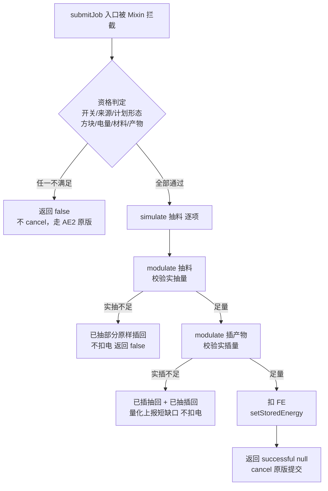

# MatterReassembler 设计方案（NeoForge 1.21.1）

> 意图真源。与代码冲突时以本文为准；变更只记 `UPDATE.md`。
> 正文写**功能语义**：效果、实现思路、边界。具体 API 签名集中在**附录 A**，正文不散布。
> 外部 API 锚点仅用于**签名核对**，不作为行为证据。**本文件所有锚点均已用 1.21.1 的实际产物 `javap` 核对过**（2026-11-14），与 1.20.1 文档的差异在 §8 集中列出。

---

## 1. 项目定位

AE2 附属方块「物质重组器」。它把 ME 网络的合成请求**旁路**：不执行样板、不经过 crafting CPU 的产物生产流程，改为「扣光材料 + 扣光 FE → 直接投放最终产物」。

一句话语义：**买时间，不买材料**。材料一分不少，样板一刻不跑，电费按产物计价。

它解决的是「配方树极深、样板极多、CPU 极慢」时的等待成本，而不是绕过配方本身。

### 1.1 概念约定

| 概念 | 语义 |
|---|---|
| 电量池 | 方块实体内部 `long`，只由外部 `IEnergyStorage` 调用改变 |
| 开启/关闭 | 关闭 = 拒绝一切能量交互、拒绝一切合成接管；外观变暗 |
| 在线 | 方块实体的 AE 网格节点处于 active（有电、有频道、已连网） |
| 接管 | 用本方块替 ME 网络完成一次合成请求的材料结算与产物投放 |
| 旁路成本 | 每次接管的 FE 成本（见 §6.3） |

---

## 2. 方块与外观

### 2.1 效果

- 默认外观：白色框架 + 中心黑洞材质（纯纹理动画实现，不写自定义渲染器）。
- 方块接入 AE 网络且节点 active：框架变为黑色。
- 关闭：外观变暗 + 红色指示灯。
- 因此外观有 **2×2 = 4 种组合**（在线与否 × 开启与否），全部由方块状态驱动。

### 2.2 实现

- 两个布尔方块状态属性：`online`（网格 active）、`enabled`（开关）。四种组合映射到四个模型变体。
- 黑洞材质用**贴图动画**（`.mcmeta` 帧序列）实现「动态」。
- `online` 由服务端每 **10 刻**比对一次「节点是否 active」与当前属性，不一致才写状态。不做每刻探测、不发自定义包。
- `enabled` 只由 §5 的交互改动。

### 2.3 边界

- 外观纯客户端可见，服务端权威值是 `enabled` 与电量；任何视觉差异不得反过来影响服务端判定。
- `online` 变化引起的模型/光照刷新有 0–10 刻延迟，属既定代价（换取零网络包）。

---

## 3. 配方与物品属性

- 一代机配方：8 个泥土，形状 3+3+2，输出 1 个本方块。
- 二代机配方：物质重组器 + `wenxingtools:custom_spawner` 无序合成。
- 物品 tooltip 固定三段：①「可以存取电量，修改AE下单方式」；②「使用消耗1万点FE，shift+右键顶面可开关」；③ 二代机追加「自带无限能源」。
- 物品与方块同注册名 `matter_reassembler` / `matter_reassembler_2`，稳定不可改。
- 采集：需正确工具（镐），掉落自身，无额外战利品表特化。

> **1.21 格式差异**：配方落在 `data/<ns>/recipe/`（单数），result 用 `{"id": ..., "count": ...}`；战利品表落在 `data/<ns>/loot_table/blocks/`（单数）。1.20 的复数目录在 1.21 不会被读取——资源在包里也等于不存在。

---

## 4. 能量系统

### 4.1 效果

- 内部电量池为 `long`，语义上界 `9,223,372,036,854,775,807` FE。
- 对外 `IEnergyStorage`：`getEnergyStored()` / `getMaxEnergyStored()` 返回 `int`，钳制到 `2,147,483,647`。
- `receiveEnergy` / `extractEnergy` 内部**全程 `long` 运算**，无中间 `int` 转换，无溢出。
- 机器**从不主动**输入或输出能量：不轮询邻居、不在 tick 里推拉、不主动向网络索取。
- 只有四个侧面参与能量交互；顶面用于开关交互，**不暴露**能量；底面**默认暴露**，可配置关闭。

### 4.2 实现

- `receiveEnergy(maxReceive, simulate)`：`space = Long.MAX_VALUE - energy`；`accepted = min(maxReceive, space)`；`simulate` 时只返回 `accepted`。
- `extractEnergy(maxExtract, simulate)`：`amount = min(maxExtract, energy)`。
- 关闭态：两者**直接返回 0**（连 `simulate` 也返回 0——外部机器据此认为「抽不动」，不会陷入每刻重试取到 0 却以为有电的错觉）。
- 面判定抽成**静态纯函数**：`isEnergyFace(Direction, exposeDown)` → 水平四面 true；`UP` false；`DOWN` 取配置；`null`（内部访问）false。
- 存档：`long` 写入 NBT（`putLong`/`getLong`）。1.21 的持久化方法带 `HolderLookup.Provider` 形参，键名与语义不变。
- **能力绑定**：NeoForge 1.21 取消了方块实体的 `getCapability` 覆写，改为注册期 `RegisterCapabilitiesEvent#registerBlockEntity(Capabilities.EnergyStorage.BLOCK, type, provider)`；provider 按面返回实例或 `null`。

### 4.3 边界

- 对外可见上限恒为 `2,147,483,647 FE`，即使内部已经存到 20 亿以上；单次 `receiveEnergy` 上限同样是 `int`，因此**注满 20 亿以上需要外部机器多次调用**。这是能力接口的硬约束，不是缺陷，须在 tooltip 与 Jade 中说明。
- 内部池不设自定上限（受 `long` 物理上界约束）；不做「饱和即蒸发」。
- 抽取在关闭态返回 0 —— 停机时能量被锁在方块内，符合「关机不响应能量操作」的语义。

---

## 5. 开关交互

### 5.1 效果

- 顶面 + 空手 + Shift + 右键 → 翻转开关，聊天栏无提示（靠外观与 Jade 反馈），客户端播放方块交互音。
- 任意其他组合（手持物品 / 未按 Shift / 非顶面）→ 完全交回原版与其它模组，不拦截、不消耗、不翻状态。

### 5.2 实现

1.21.1 把方块交互拆成两个方法：`useItemOn`（主手持物品）与 `useWithoutItem`（主手为空）。本方块**只覆写 `useWithoutItem`**：

- 「空手」由引擎保证——比 1.20.1 手写 `heldItem.isEmpty()` 更严格：手持任何物品的交互根本不会走到这里。
- 判定顺序固定为：`player.isShiftKeyDown()` → 命中面 `== Direction.UP` → 服务端执行。任一条不满足直接返回 `InteractionResult.PASS`，保证其它模组的 Shift+右键 交互不被吞。
- 只在服务端翻转（`level.isClientSide` 早退），翻转后写方块状态，存档由 `setChanged()` 触发。
- **刻意不调 `super.useWithoutItem`**：AE2 的空手默认交互对本方块没有业务；1.20.1 端对 `onActivated` 的覆写同样没有转发，两版语义保持一致。
- **注释必须写明**：空手判定是为了不与「手持物品的 Shift+右键」冲突；这是本方块唯一的物品交互面豁免点。

### 5.3 边界

- 关闭态下仍可被重新打开（开关不受电量与网络状态限制）。
- 副手持有物品不影响（只看主手），这是刻意的：避免「副手火把 + 空主手」时无法开关。

---

## 6. 合成接管（核心）

### 6.1 效果

玩家在 AE2 合成确认界面点「开始」时，若本模组接管：

- 材料按原计划的 `usedItems()` 从 ME 网络**原样扣除**（「扣中间产物而不是原料」由 AE2 计算阶段决定，本模组不改）。
- 不创建 crafting CPU 任务、不执行任何样板、不占用 CPU 存储。
- 产物 `finalOutput()` **直接插入 ME 网络**（与 CPU 完成任务时把产物交回网络的效果一致）。
- 按 §6.3 扣 FE。
- 界面对玩家呈现「请求成功」，物品即刻出现在网络里。

不满足任何一条资格条件 → 完全走 AE2 原版路径（本模组不介入）。

### 6.2 实现

**拦截点（设计裁定 D2）**：注入 AE2 合成服务的 `submitJob` 方法**入口**（可取消），而不是注入 `beginCraftingCalculation` 的返回。理由：

1. 只有「确认提交」这一刻玩家才真的要合成；在计算完成时就扣电，玩家点取消后电已扣（风险 R2）。
2. 计算完成回调运行在计算线程，`submitJob` 在服务端线程——副作用天然在主线程。
3. `beginCraftingCalculation` 的返回值仍需原样给确认界面做**真实材料/字节展示**，不篡改能避免 UI 与真实结算不一致。

**为什么必须在提交时刻自行结算（设计裁定 D1，关键）**：把「`patternTimes` 为空」的计划交回 CPU 不会报错，但会让任务**永久挂起**（证据链见 §7）。因此接管时本模组自己完成「扣料 + 投放产物 + 扣电」，并把原版提交短路为「成功」，**不创建任何 CPU 任务**。

**接管资格（全部为真才接管）**：

| 条件 | 判定来源 | 说明 |
|---|---|---|
| 主开关开启 | 配置 | 全局停用开关 |
| 请求来自玩家 | `requestingMachine == null` | 机器/自动化请求**不接管**，交回原版（边界 B1） |
| 计划非模拟 | `!plan.simulation()` | 缺料计划不接管 |
| 计划无缺失项 | `plan.missingItems().isEmpty()` | 模拟标记与缺失项不一致时的兜底 |
| 计划有主产物 | `plan.finalOutput() != null` | 没有主产物时接管会扣材料却不投产物，必须拦下（`NO_FINAL_OUTPUT`） |
| 存在合格方块 | 网格内本方块实体集合 | 至少一台：节点 active + 开启 + 已加载 |
| 电量足够 | 最高电量 ≥ 成本 | 多台取电量最多者（同电量按坐标，保证确定性） |
| 材料可全部抽取 | 网络库存 `simulate` 抽取逐项通过 | 任何一项不足即不接管 |
| 产物可全部插入 | 网络库存 `simulate` 插入足量 | 插不进就交回原版，避免「材料扣了产物塞不下」 |

**执行序（严格顺序，任一步失败回滚）**：

1. 主线程：逐项 `simulate` 抽取材料，全通过才继续。
2. 主线程：`simulate` 插入产物（同一 key 既抽又插时取**净额**），逐项通过才继续。
3. 主线程：`MODULATE` 逐项抽取材料，**校验实抽量**；不足立刻回滚。
4. 主线程：`MODULATE` 插入产物；不足则整体回滚（已插抽回、已抽插回）。
5. 主线程：扣 FE、`setChanged()`。
6. 返回「提交成功、无链接」。

**收支核算抽成不依赖 `Level` 的纯类**（抽象出最小「库存」接口：`extract(simulate)` / `insert(simulate)`），以便 T1 探针覆盖回滚路径。这是本设计最重要的可验证性安排。

> **实现细化（1.20.1 落地时定稿，1.21.1 沿用）**：
> 1. 判定与结算**共享同一份 simulate 结论**（账本先出 `preflight`，判定拿它做条件表，之后才 modulate）。两处各算一遍会在并发下漂移成「判定说能、结算才发现不能」，玩家看到的是点击后无反应。
> 2. 第 3 步 modulate 抽料后**必须校验实抽量**：simulate 通过而实抽不足只能是被并发请求抢走，此时立刻回滚并交回原版——绝不继续插产物（那会凭空生成材料）。
> 3. 回滚的完整性要**量化上报**：账本返回「未能还原的数量合计」，非 0 时执行器记 warn。
> 4. 同一 key 既被抽又被插时，simulate 插入位需求取**净额**；真正插入仍按全额，插不下照样回滚。

### 6.3 计费口径（默认按次）

- **默认按次计费**：`总成本 = energyPerJob`（默认 **10,000**），一次接管一次性扣除，与请求数量无关。
- 这是开发者的明确选择：旁路成本是「开一次旁路」的门票钱，不随产物数量浮动；想按量收费时把 `chargeMode` 改成 `PER_UNIT` 即可（`总成本 = energyPerUnit × 单位数`），不改代码。
- 已记录的取舍：按次计费下，一次请求 1000 个与请求 1 个成本相同——这是**有意**的（`AGENTS.md` §8 R5）。
- 单位数口径（`PER_UNIT` 时才用到）：可堆叠物品按个数；其它键类型按 `finalOutput().what().getAmountPerUnit()` 归一，非整数**向上取整**（保守一侧）。
- 计数与扣除都在服务端线程、与材料结算同一原子段完成：材料扣不动或产物投不下时**一分钱不扣**。

### 6.4 边界

| 编号 | 边界 |
|---|---|
| B1 | 机器/Crafting Card 等 `ICraftingRequester` 请求**不接管**：它们需要链接与请求清单，替代语义会打破其状态机。 |
| B2 | 材料不足、产物插不下、电量不足 → 一律交回原版，本模组不产生任何「部分完成」。 |
| B3 | 原版确认界面要求「选中的 CPU 存储足够计划字节」，本模组不创建 CPU 任务但仍走该前置：没有可用 CPU 时无法发起合成，因此也无法触发旁路。 |
| B4 | 接管成功后 CPU 面板不出现任务——这是刻意语义（没有任务）。 |
| B5 | 一次接管 = 一次请求的全部数量；中途取消的概念不存在（结算瞬间完成）。 |
| B6 | 不接管 AE2 的「自动补充/自动合成」在后台发起的请求（同 B1）。 |
| B7 | 计划里的 `emittedItems()`（副产物/容器物）**按原样插入网络**，不丢弃——否则容器类配方会吞桶吞瓶。 |
| B8 | 与「子网」「无线终端」无差别：只认发起请求的网格。 |

---

## 7. 「空 `patternTimes` 会被接受吗」——风险裁定（必读）

### 7.1 结论

**不会被拒绝，但会让 CPU 永久挂起。** 任务不崩、不报错、不完成。

### 7.2 证据链（来源：AE2 1.20.1 分支源码，1.21 侧已核对接口签名不变）

1. 提交路径的校验只有三条：已有任务 → CPU_BUSY；节点不 active → CPU_OFFLINE；`availableStorage < plan.bytes()` → CPU_TOO_SMALL。**没有任何针对 `patternTimes` 的校验**。
2. 通过校验后立即 `tryExtractInitialItems(plan, …)`：按 `plan.usedItems()` 逐项从网络抽取到 CPU 内部库存（真实扣料）。
3. 任务对象构造时：`remainingAmount = finalOutput().amount()`；`waitingFor` 来自 `emittedItems()`；`tasks` 来自 `patternTimes()` 逐项累加。
4. 完成任务**只有一个出口**：产物被插入 CPU 时把 `remainingAmount` 减到 0 → `finishJob(true)`。
5. 空 `patternTimes` ⇒ `tasks` 为空 ⇒ 没有样板被执行 ⇒ 没有产物入账 ⇒ `remainingAmount` 永不归零 ⇒ **任务挂起**；材料滞留 CPU 内部库存，直到玩家取消或 CPU 被拆除才回到网络。

**1.21.1 侧复核**：`ICraftingPlan` 的八个方法（`finalOutput` / `bytes` / `simulation` / `multiplePaths` / `usedItems` / `emittedItems` / `missingItems` / `patternTimes`）与 1.20.1 **逐字一致**（T0 `javap` 实测），上述推理链的所有前提在 19.2.19 上继续成立。

### 7.3 方案比较

| 方案 | 做法 | 结论 |
|---|---|---|
| A. 空 `patternTimes` 交回 CPU | 按原提示词 | **否决**：材料进 CPU 后挂死，CPU 被占 |
| B. 放一个「永不执行的占位样板」 | `patternTimes` 放虚拟 `IPatternDetails` | **否决**：CPU 会向各 provider 推送该样板，永不完成，等价于 A 更差 |
| C. Mixin 放宽 CPU 校验并代其完成 | 改 `CraftingCpuLogic` | **否决**：注入面扩大到 tick 主循环与完成判定，AE2 小版本升级即碎 |
| **D. 不把交付交给 CPU（采纳）** | 在提交入口短路：自行扣料 + 投放产物 + 扣电，返回成功 | 只有一处 HEAD 注入、描述符只依赖 AE2 自有类型；CPU 完全不参与 |

---

## 8. 1.20.1 → 1.21.1 的 API 映射（本仓库迁移的判据表）

> 每一行都来自对 1.21.1 实际产物的 `javap` 核对（AE2 19.2.19 / NeoForge 21.1.200 / Jade 15.10.6），不是记忆。

| 功能面 | 1.20.1（Forge） | 1.21.1（NeoForge） |
|---|---|---|
| 模组入口 | `@Mod` + `FMLJavaModLoadingContext.get().getModEventBus()` | `@Mod` 构造器注入 `(IEventBus, ModContainer)` |
| 注册表 | `ForgeRegistries.BLOCKS/ITEMS/BLOCK_ENTITY_TYPES` | `Registries.BLOCK/ITEM/BLOCK_ENTITY_TYPE` |
| 注册返回类型 | `RegistryObject<T>` | `DeferredHolder` / `DeferredBlock` / `DeferredItem` |
| 方块注册 | `DeferredRegister<Block>.register` | `DeferredRegister.Blocks#registerBlock(name, ctor, props)`（注册方补 `setId`） |
| 配置 | `ForgeConfigSpec` + `ModLoadingContext.get().registerConfig` | `ModConfigSpec` + `ModContainer#registerConfig` |
| 能量能力 | 方块实体覆写 `getCapability` + `ForgeCapabilities.ENERGY` + `LazyOptional` | `RegisterCapabilitiesEvent#registerBlockEntity` + `Capabilities.EnergyStorage.BLOCK` |
| AE2 网格接入 | 方块实现网格接口即可，Forge 的能力桥接自动把方块实体暴露给线缆 | **必须显式注册 `AECapabilities.IN_WORLD_GRID_NODE_HOST`**（provider 返回方块实体自身）；漏注册不报错，线缆静默看不见该方块 |
| AE2 网格基类 | `AENetworkInvBlockEntity` | **`AENetworkedBlockEntity`**（无库存）/ `AENetworkedInvBlockEntity`（有库存）——旧类已删除 |
| 方块交互 | `AEBaseBlock#onActivated(Level, BlockPos, Player, InteractionHand, ItemStack, BlockHitResult)` | **`useWithoutItem(BlockState, Level, BlockPos, Player, BlockHitResult)`** / `useItemOn(...)` |
| NBT 持久化 | `loadTag(CompoundTag)` / `saveAdditional(CompoundTag)` | `loadTag(CompoundTag, HolderLookup.Provider)` / `saveAdditional(CompoundTag, Provider)` |
| 资源位置 | `new ResourceLocation(ns, path)` | `ResourceLocation.fromNamespaceAndPath(ns, path)`（构造器已移除） |
| 物品 tooltip | `appendHoverText(ItemStack, Level, List, TooltipFlag)` | `appendHoverText(ItemStack, Item.TooltipContext, List, TooltipFlag)` |
| 创造栏排序 | `withTabsBefore(ResourceKey…)` | 同（`CreativeModeTabs.REDSTONE_BLOCKS` 仍是 `ResourceKey`） |
| 方块实体工厂 | `BlockEntityType.Builder.of(supplier, blocks).build(null)` | 同 |
| 方块实体 ticker 接线 | `setBlockEntity(class, type, serverTicker, clientTicker)`（看着像服务端在前） | 同签名，但**实际语义是 `(class, type, clientTicker, serverTicker)`**——第 3 位是客户端。传反不报错，只会让服务端 ticker 变 null（两版字节码逐字一致） |
| 配置 `defineInRange` | `defineInRange(key, long, min, max)` → `LongValue` | 同签名仍在；另有泛型版 `defineInRange(key, V, V, V, Class<V>)` → `ConfigValue<V>` |
| 数据目录 | `recipes/`、`loot_tables/` | **`recipe/`、`loot_table/`**（单数，复数路径不被读取） |
| 配方 result | `{"item": "...", "count": 1}` | `{"id": "...", "count": 1}` |
| 元数据文件 | `META-INF/mods.toml` | **`META-INF/neoforge.mods.toml`** |
| 依赖声明 | `mandatory=true/false` | `type="required"/"optional"` |
| Mixin 声明 | `manifest` 或独立配置 | `neoforge.mods.toml` 的 `[[mixins]] config="..."` |
| Java / Mixin 级别 | Java 17 / `JAVA_17` | Java 21 / `JAVA_21` |
| AE2 API 锚点 | `ICraftingPlan` 8 方法 / `IGrid#getMachines` / `MEStorage#extract,insert` | **全部同名同参**（T0 逐字核对） |

---

## 9. Jade 信息显示

### 9.1 效果

准星指向方块时显示四项：

| 字段 | 文案（中文） | 取值 |
|---|---|---|
| 网络 | `已接入 ME 网络` / `未接入` | 节点 active |
| 状态 | `运行中` / `已关闭` | `enabled` |
| 电量 | `9,223,372,036,854,775,807 FE`（二代机显示「无限」） | 内部 `long`，千位分隔 |
| 吞吐 | `2,147,483,647 FE/次` | 接口单次上限常量 |

### 9.2 实现

- 插件用 Jade 的注解式注册：一个实现 `IWailaPlugin` 的类 + `@WailaPlugin`；在注册回调里做两次登记——**服务端数据提供者**（键为方块实体类）与**客户端组件提供者**（键为方块类）。
- 服务端数据里放 `energy`(long)、`enabled`(bool)、`online`(bool)、`throughput`(int)、`infinite`(bool)。**不复用 `getUpdateTag`**：那会把 8 字节 long 塞进每个玩家的块实体全量包，而 Jade 的数据通道只在准星指向时按需发送。
- 客户端只做「读数据 → 格式化 → 追加行」，不做任何计算或网络请求。
- 数字格式化抽成静态纯函数（`FeFormat`：`%,d` + 单位后缀，固定 `Locale.ROOT`），供 Jade 与 tooltip 共用。
- **1.21 差异**：客户端组件接口从 `IBlockComponentProvider` 收敛为泛型 `IComponentProvider<BlockAccessor>`；`ResourceLocation` 走静态工厂。
- 未装 Jade：插件类不被加载即可（不在主类里 `new` 它、不 import 到公共路径），其余功能正常。

### 9.3 边界

- Jade 显示的电量是「准星指向那一刻」的服务端快照，最多滞后一个客户端 tick。
- 关闭态仍显示电量（玩家需要知道停机时池里还有多少）。
- 若某次服务端数据缺失（方块实体刚被移除），客户端显示 `-` 而不是 `0`，避免误读。

---

## 10. 配置项（`ModConfigSpec`）

| 键 | 类型 | 默认 | 语义 |
|---|---|---|---|
| `takeoverEnabled` | bool | true | 合成接管总开关（关闭后本模组只当储电方块） |
| `energyPerJob` | long | 10000 | 每次接管 FE 成本（`PER_JOB` 生效） |
| `energyPerUnit` | long | 100000 | 每产物单位 FE 成本（`PER_UNIT` 生效） |
| `chargeMode` | enum | `PER_JOB` | `PER_JOB`（默认，按次）/ `PER_UNIT`（按量） |
| `exposeDownFace` | bool | true | 底面是否暴露能量接口 |
| `debugLogging` | bool | false | 接管**成功**路径的细节日志（不接管的 **info** 日志始终打，无需开关） |

配置键名一旦发布不得重命名（会静默重置玩家存档配置）。

> **只放有消费者的键**：1.20.1 端清理过 `pollCoverInterval` 与 `relaxCpuByteRequirement` 两个悬空键，本迁移版不带回。现存 6 个键逐键有消费点。

---

## 11. 可验证性设计（设计门禁）

| # | 核心断言 | 级别 | 落地形态 |
|---|---|---|---|
| 1 | `long` 池加法不溢出（`receive` 到 `Long.MAX_VALUE` 后仍返回 0） | **T1** | 静态纯函数/纯类 |
| 2 | `getEnergyStored`/`getMaxEnergyStored` 钳制到 `Integer.MAX_VALUE` | **T1** | 纯函数 |
| 3 | 能量面白名单（UP 否、水平是、DOWN 依配置、null 否） | **T1** | 静态纯函数 |
| 4 | 关闭态所有能量操作返回 0（含 simulate） | **T1** | 纯函数 |
| 5 | 接管资格判定（开关/模拟/敌方请求/缺失项/主产物/电量/材料/产物） | **T1** | 静态纯函数（输入为布尔与数值） |
| 6 | 收支账本：正常路径、材料不足、产物插不下、第 4 步回滚 | **T1** | 纯类 + 抽象库存接口 |
| 7 | 计费口径（PER_UNIT / PER_JOB，含向上取整） | **T1** | 静态纯函数 |
| 8 | FE 千位格式化（含 0、`Long.MAX_VALUE`、负数拒绝） | **T1** | 静态纯函数 |
| 9 | 方块/物品/方块实体注册与创造栏出现 | **T2** | 无头冒烟 |
| 10 | Mixin 注入成功、AE2 正常加载 | **T2** | 无头冒烟（强制门） |
| 11 | 配方/战利品表以单数路径进入产物 | **T0** | `unzip -l` |
| 12 | 元数据 modId/依赖/mixins 声明正确 | **T0** | `unzip -p … neoforge.mods.toml` |
| 13 | 实际合成 8 泥土出本方块 | **T3** | 开发者 |
| 14 | 顶面空手 Shift+右键开/关，外观与 Jade 同步变化 | **T3** | 开发者 |
| 15 | 手持物品时 Shift+右键不被本模组吞掉 | **T3** | 开发者（含第三方模组物品） |
| 16 | 旁路端到端（扣料/产物/扣电/无 CPU 任务） | **T3** | 开发者 |

T3 占比 4/16 = 25%，未过半，设计门禁通过。**改动任何一条 T1 断言所属逻辑时，必须同步本表**。

---

## 12. 非目标

- 不做 EU/AE 的直接实现（转换由 AE2 能源接收器与其它模组负责）。
- 不做自定义 GUI（本方块无界面）。
- 不做「按配方树深度分级计费」。
- 不做 Forge / 1.20.1 兼容（真源在另一仓库）。
- 不接管自动化请求（B1）。
- 不改 AE2 的样板、provider、CPU 任何内部逻辑。

---

## 13. 有意设计

| 现象 | 裁定 |
|---|---|
| 旁路后 CPU 面板无任务 | 有意：语义上就是「没有任务」 |
| 单次能量交互上限 21 亿（需多次调用） | 接口硬约束，非缺陷 |
| 停机时能量被锁在方块内 | 有意（关机不响应能量操作） |
| 无可用 CPU 时无法发起旁路 | 有意（保持原版确认前置） |
| 一次接管瞬时完成、无取消 | 有意 |
| 手持物品时 Shift+右键 不翻开关 | 有意：把该组合完整让给其它模组 |
| 二代机与一代机外观完全相同 | 有意：差别在能量，不在外观 |

---

## 14. 实施路线（分波，每波可独立验收）

> 粒度：每波一个可交付单元；**每波结束必须能跑出本节列出的验证命令**。

### Wave 0 · 基建与签名核对（已完成，2026-11-14）

1. `gradle.properties` 改名（mod_id / mod_name / group / authors / description）。
2. 依赖接入：AE2 19.2.19 与 Jade 15.10.6 放 `libs/`，`compileOnly` + `localRuntime`。
3. 附录 A 锚点对 AE2 19.2.19 / NeoForge 21.1.200 / Jade 15.10.6 实际产物 `javap` 核对。
4. `neoforge.mods.toml` 写 modId、四个依赖、`[[mixins]]`；`generateModMetadata` 的展开键补齐。

验证：`./gradlew build --offline` exit=0；产物含 `META-INF/neoforge.mods.toml`（T0）。

### Wave 1 · 方块 + 方块实体 + 能量 + 开关（已完成）

1. 方块类（泛型化、两个方块状态属性、`useWithoutItem` 开关、ticker 注册）。
2. 方块实体：`AENetworkedBlockEntity` 基类，构造期 `setIdlePowerUsage(0)`。
3. 能量适配器：`long` 池 + `IEnergyStorage`（`int` 钳制）、面白名单、关闭态拒付。
4. NBT 持久化（`HolderLookup.Provider` 形参）、`enabled` 状态写回、`online` 每 10 刻复核。
5. 能力绑定迁移到 `RegisterCapabilitiesEvent`。

验证：T1 探针（断言 1–4）；T0 产物含全部 class 与资源。

### Wave 2 · 接管判定 + 收支账本（已完成，纯类零改动）

1. 纯类：`ChargeMode`、`TakeoverCost`、`TakeoverDecision`、`LedgerInventory`、`Ledger`。
2. 单元探针放 `.rivet/scratch/`，交付前删除；断言逐条 `PASS/FAIL`。

验证：T1 探针（断言 5–8）。

### Wave 3 · Mixin 接入 + 接管执行（已完成）

1. `mixins.json`（`JAVA_21`、`injectors.defaultRequire=1`）+ `CraftingServiceMixin`（HEAD、cancellable、`remap=false`）。
2. 服务端线程保证：不解析 `Future`、不跨线程；执行器加 `isSameThread()` 断言。
3. 失败路径：账本失败 → **不取消**，交回原版。
4. `neoforge.mods.toml` 声明 `[[mixins]]`。

验证：`runServer` 出现 `Mixing CraftingServiceMixin … into appeng.me.service.CraftingService` 且无 `ERROR`（T2，**强制门**）。

### Wave 4 · Jade + 收尾（已完成）

1. Jade 插件（服务端数据 + 客户端组件，泛型接口）+ 格式化函数复用。
2. tooltip 三段文案、中英文语言键全覆盖。
3. 配置项接线与默认值核对（§10）。
4. 文档对齐：`DESIGN`、`AGENTS`、`UPDATE` 三件套。
5. 产物核对 + 交付报告证据栏。

验证：T0（断言 11、12）；T3 测点（Jade 四项显示、开关与在线状态变化）。

### Wave 5 · 审查修正（已完成，2026-11-14）

1. 资格判定新增「计划有主产物」否决路径，插在「计划形态」组内（先 RED 后 GREEN，3 条新断言）。
2. 不接管日志降噪：摘要保持 info，逐台明细降到 debug（`debugLogging` 或日志级别任一触发），并补空元素防御。
3. 去掉方块实体里多余的保存钩子覆写——1.21 基类已提供实现且带 tick 末合并，自己写反而绕过去。

验证：T1 `47 passed / 0 failed`；`build` exit=0；T2 `Done` + 0 ERROR + 0 配方错误。

---

## 15. 物质重组器 2（自带无限能源）

### 15.1 效果

- 外观、开关交互、Jade 显示与一代完全一致；差别只在方块实体**自带无限能源**：取电永远够（合成接管的成本判定永远通过）、外接充电照收（返回「全收了」但不改状态）、扣电无效。
- Jade 的电量行显示「无限」而不是一串天文数字。
- 配方：物质重组器 + wenxing 刷怪笼（`wenxingtools:custom_spawner`）无序合成。

### 15.2 实现

- 方块类泛型化（`MatterReassemblerBlock<T extends MatterReassemblerBlockEntity>`）；二代机 `InfiniteMatterReassemblerBlock` 只继承不复写：两代机器的方块行为必须永远一致。
- 无限能源是父类方块实体上的 `infiniteEnergy` 标志，分派在四条路径：`getStoredEnergy` / `setStoredEnergy` / `addEnergy` / `IEnergyStorage` 适配器的三个方法。子类只在构造时置位。
- 该标志是**方块种类属性**，不进存档。
- 二代机复用父类的 ticker（`BlockEntityTicker<T>` 的参数位是 T，方法引用参数逆变）。
- 注册四件：方块、同名物品、同名方块实体类型、能力绑定；两代机都进创造栏。

### 15.3 边界

- 无限能源**不绕开关**：关机仍拒收，Jade 仍显示「未接入」。
- 不改变计费口径：接管照常扣电，只是扣在无限池上等于没扣。
- 共用同一套模型/贴图——外观一致是有意的，差别在能量。

---

## 附录 A · 外部契约锚点（1.21.1 实际产物核对，2026-11-14）

来源：`appliedenergistics2-19.2.19.jar`（Modrinth CDN 下载）、`neoforge-21.1.200-merged.jar`（本仓库 `build/moddev/artifacts/`）、`Jade-1.21.1-NeoForge-15.10.6.jar`。全部用 `javap` 逐条核对。

### A.1 AE2 19.2.19

| 锚点 | 实测签名 |
|---|---|
| `appeng/api/networking/IGrid` | `<T> Set<T> getMachines(Class<T>)`、`<T> Set<T> getActiveMachines(Class<T>)`、`default IStorageService getStorageService()` |
| `appeng/api/networking/crafting/ICraftingPlan` | `GenericStack finalOutput()` / `long bytes()` / `boolean simulation()` / `boolean multiplePaths()` / `KeyCounter usedItems()` / `KeyCounter emittedItems()` / `KeyCounter missingItems()` / `Map<IPatternDetails, Long> patternTimes()` |
| `appeng/api/networking/crafting/ICraftingSubmitResult` | `boolean successful()` / `CraftingSubmitErrorCode errorCode()` / `Object errorDetail()` / `ICraftingLink link()` |
| `appeng/crafting/execution/CraftingSubmitResult` | `static ICraftingSubmitResult successful(ICraftingLink)` |
| `appeng/me/service/CraftingService` | `public ICraftingSubmitResult submitJob(ICraftingPlan, ICraftingRequester, ICraftingCPU, boolean, IActionSource)`；字段 `private final IGrid grid` ← **本项目唯一注入点** |
| `appeng/api/storage/MEStorage` | `default long insert(AEKey, long, Actionable, IActionSource)`、`default long extract(AEKey, long, Actionable, IActionSource)` |
| `appeng/api/stacks/KeyCounter` | `implements Iterable<Object2LongMap.Entry<AEKey>>`（for-each + `getKey()/getValue()` 可用） |
| `appeng/api/stacks/GenericStack` | record；`what()` / `amount()` |
| `appeng/block/AEBaseEntityBlock` | `extends AEBaseBlock implements EntityBlock`；`public void setBlockEntity(Class<T>, BlockEntityType<T>, BlockEntityTicker<T>, BlockEntityTicker<T>)`；`public InteractionResult useWithoutItem(BlockState, Level, BlockPos, Player, BlockHitResult)`；`public ItemInteractionResult useItemOn(ItemStack, BlockState, Level, BlockPos, Player, InteractionHand, BlockHitResult)` |
| `appeng/blockentity/grid/AENetworkedBlockEntity` | `extends AEBaseBlockEntity implements IGridConnectedBlockEntity`；构造器 `(BlockEntityType<?>, BlockPos, BlockState)`；`protected IManagedGridNode createMainNode()`；`public final IManagedGridNode getMainNode()`；`loadTag(CompoundTag, HolderLookup.Provider)` |
| `appeng/me/helpers/IGridConnectedBlockEntity` | 强制 `getMainNode()` + `saveChanges()`；`getGridConnectableSides` 等为 default |
| `appeng/api/networking/IManagedGridNode` | `setIdlePowerUsage(double)` / `isActive()` / `getNode()` / `destroy()` 等 |

**已删除的旧锚点（1.20.1 有、1.21.1 没有）**：`appeng/blockentity/grid/AENetworkInvBlockEntity`、`AEBaseBlock#onActivated`。

### A.2 NeoForge 21.1.200

| 锚点 | 实测签名 |
|---|---|
| `net/neoforged/neoforge/energy/IEnergyStorage` | `receiveEnergy(int, boolean)` / `extractEnergy(int, boolean)` / `getEnergyStored()` / `getMaxEnergyStored()` / `canExtract()` / `canReceive()` |
| `net/neoforged/neoforge/capabilities/Capabilities$EnergyStorage` | `public static final BlockCapability<IEnergyStorage, Direction> BLOCK` |
| `net/neoforged/neoforge/capabilities/RegisterCapabilitiesEvent` | `<T, C, BE extends BlockEntity> void registerBlockEntity(BlockCapability<T, C>, BlockEntityType<BE>, ICapabilityProvider<? super BE, C, T>)` |
| `net/neoforged/neoforge/registries/DeferredRegister` | `static DeferredRegister.Blocks createBlocks(String)` / `createItems(String)` / `<T> create(ResourceKey<? extends Registry<T>>, String)` |
| `DeferredRegister$Blocks` | `registerBlock(String, Function<Properties, ? extends B>, Properties)` / `registerBlock(String, Function<Properties, ? extends B>)` |
| `DeferredRegister$Items` | `registerItem(String, Function<Item.Properties, ? extends I>)` |
| `net/neoforged/neoforge/common/ModConfigSpec$Builder` | `define(String, T)` / `defineInRange(String, long, long, long)` → `LongValue` / `defineInRange(String, V, V, V, Class<V>)` → `ConfigValue<V>` / `defineEnum(String, V)` / `push(String)` / `pop()` / `comment(String...)` |
| `net/neoforged/fml/ModContainer` | `registerConfig(ModConfig.Type, IConfigSpec)` |
| `net/neoforged/fml/event/lifecycle/FMLCommonSetupEvent` | 存在于 FML loader jar（不在 merged jar） |
| `net/minecraft/world/item/Item` | `appendHoverText(ItemStack, Item.TooltipContext, List<Component>, TooltipFlag)` |
| `net/minecraft/world/level/block/entity/BlockEntity` | `protected loadAdditional(CompoundTag, HolderLookup.Provider)` / `saveAdditional(CompoundTag, HolderLookup.Provider)`；**无 `getCapability`** |
| `net/minecraft/resources/ResourceLocation` | `static fromNamespaceAndPath(String, String)`；公开构造器已移除 |
| `net/minecraft/world/level/block/entity/BlockEntityType$Builder` | `static of(BlockEntitySupplier<T>, Block...)` / `build(Type<?>)` |
| `net/minecraft/world/item/CreativeModeTab$Builder` | `withTabsBefore(ResourceKey<CreativeModeTab>...)` / `withTabsBefore(ResourceLocation...)` |

### A.3 Jade 15.10.6

| 锚点 | 实测签名 |
|---|---|
| `snownee/jade/api/IWailaPlugin` | `default register(IWailaCommonRegistration)` / `default registerClient(IWailaClientRegistration)` |
| `snownee/jade/api/IWailaCommonRegistration` | `registerBlockDataProvider(IServerDataProvider<BlockAccessor>, Class<?>)` |
| `snownee/jade/api/IWailaClientRegistration` | `registerBlockComponent(IComponentProvider<BlockAccessor>, Class<? extends Block>)` |
| `snownee/jade/api/IComponentProvider` | `appendTooltip(ITooltip, T, IPluginConfig)`；`getIcon` 为 default |
| `snownee/jade/api/IServerDataProvider` | `appendServerData(CompoundTag, T)` |
| `snownee/jade/api/IJadeProvider` | `ResourceLocation getUid()` |
| `snownee/jade/api/BlockAccessor` | `BlockEntity getBlockEntity()` / `BlockState getBlockState()`；`getServerData()` 来自 `Accessor` |

---

## 附录 B · 未核实项与待定决策

| 编号 | 事项 | 处置 |
|---|---|---|
| B-1 | AE2 19.x 的 `AENetworkedBlockEntity#getCableConnectionType` 默认返回值 | 未覆写；方块不接入线缆。若实机发现连接类型导致异常，再按 `AECableType` 覆写 |
| B-2 | `maven.modrinth:ae2:<ver>` 坐标能否直接解析（本项目改用 `libs/`） | 未验证为「不可用」，只是**未采用**：本地 jar 让构建完全离线可重现。若要改远程 maven，先单独验证坐标解析 |
| B-3 | 1.21 的 `neoforge:conditional` 配方条件是否可用 | **未验证**。二代机配方仍用普通 shapeless（1.20.1 端 `forge:conditional` 运行期不可用）。若 1.21 支持，可改成条件配方以避免「未装 wenxingtools 时刷日志」 |
| B-4 | 无头 `runServer` 中 AE2 19.x 能否完整加载（它自身依赖 guide 等 jarJar 内嵌件） | 由 T2 冒烟回答；失败则降级为「Mixin 注入只能由开发者实机验证」，并在交付报告标 `unverified: T2` |
| B-5 | `AEBaseEntityBlock#setBlockEntity` 在 1.21 是否仍适合放在 `FMLCommonSetupEvent` | 采用 1.20.1 的同一时机（注册完成后绑定）。若 T2 出现 ticker 未生效，改用 `RegisterEvent` 末尾绑定 |
